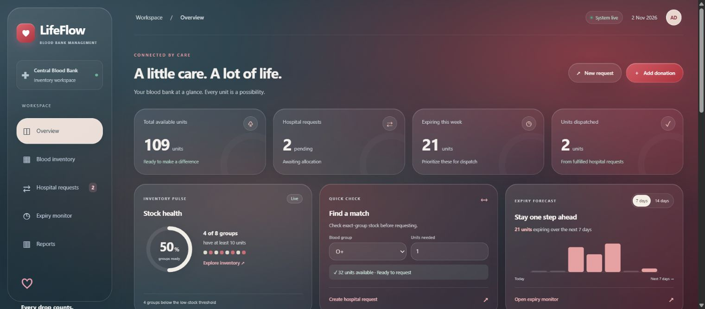

<div align="center">


# LifeFlow
### Every Drop Connects a Life.

Blood inventory · Expiry tracking · Hospital requests

**[Open LifeFlow — Live Demo](https://lifeflow-eta.vercel.app/)**


[Quick start](#run-locally) · [Features](#features-and-business-rules) · [Lab report](docs/LAB_REPORT.md) · [API](#api)

</div>

---


A complete B.Tech 3rd-year Web Technology lab project. Tracks blood-group inventory, batch expiry dates and hospital requests with SQLite locally and Supabase PostgreSQL on Vercel.



## Run locally

1. Install **Node.js 24 or later** (the project uses its built-in SQLite module).
2. Clone the repository and open its folder:

   ```bash
   git clone https://github.com/Wknd-0424/Lifeflow.git
   cd Lifeflow
   ```
3. Run `npm ci`. Set `LIFEFLOW_ADMIN_PASSWORD` in the server environment to a unique password of at least 20 characters, then run `npm start`.
4. Open **http://localhost:3000** in your browser.

Local mode uses SQLite and needs no database server or API keys. Cloud mode uses the `pg` package to connect to Supabase. Node may print an experimental SQLite warning; the application still runs normally. To change the port in PowerShell: `$env:PORT=3001` then `npm start`.

The database is created at `data/bloodbank.sqlite`. The first launch loads fictional donation batches and hospital requests relative to the current date. Records persist after restarting. To start fresh, stop the server and rename the `data` folder before restarting. Do not use real patient information in this demonstration.

## Demonstration workflow

1. View the dashboard: available units, pending requests, expiring units and dispatch totals.
2. Choose **Add donation**, enter a donor/source, group, unit count, collection date and label expiry date.
3. Open **Blood inventory** and filter by group, batch/source or stock status.
4. Choose **New request**, enter the hospital, contact, blood group, units and priority.
5. Open **Hospital requests** and click **Fulfill**. Confirm dispatch; the server deducts inventory automatically.
6. Try requesting more units than are available. The request remains pending and stock stays unchanged.
7. View **Expiry monitor** for expired and soon-to-expire batches.
8. Download inventory and request CSVs from **Reports**.

## Features and business rules

- Eight blood groups: A+, A−, B+, B−, AB+, AB−, O+, O−.
- Batch-level remaining stock, collection date, expiry date and donor/source.
- Availability excludes expired and depleted batches. Low stock means fewer than 10 units.
- Expiry alerts include today through the next 7 days. A batch remains available through its labelled expiry date, using UTC calendar dates consistently on the server.
- Requests move from Pending to Fulfilled or Cancelled. Processed requests cannot be processed again.
- Fulfillment uses **exact blood-group matching**, allocates earliest expiry first (FEFO), and succeeds only if the whole quantity is available.
- SQLite transactions make allocation and status updates atomic. Allocations retain a request-to-batch audit trail.
- Input validation runs in both browser and server; database constraints prevent negative remaining stock.
- Search, filters, CSV export, activity feed, responsive layout and accessible native forms/dialogs.
- Glassmorphism surfaces with frosted backgrounds, soft gradients, hover effects and reduced-motion support.
- Responsive stock-health ring, an interactive blood availability checker that prefills requests, and a switchable 7/14-day expiry forecast.

## Technology and architecture

| Layer | Technology | Responsibility |
|---|---|---|
| Frontend | HTML5, CSS3, vanilla JavaScript | Responsive views, forms, filters, CSV export |
| Backend | Node.js HTTP server | REST endpoints, JSON validation, static assets |
| Database | SQLite through `node:sqlite` | Persistent inventory, requests, allocations, activity |
| Tests | Built-in `node:test` | Allocation, validation, cancellation and expiry rules |

```text
Browser → HTTP / JSON API → business rules → SQLite
```

## Project structure

```text
public/index.html     Application shell and forms
public/styles.css     Responsive dashboard design
public/glass.css      Glass theme, dashboard widgets and device breakpoints
public/app.js         Views, forms, API calls, filters and exports
api/index.js          Vercel API entry point
lib/store.js          Schema, seed data, validation and transactional allocation
lib/postgres-store.js Cloud database adapter and transactional allocation
lib/supabase-ca.crt   Trusted certificate for cloud database connections
server.js             HTTP server and routes
test/store.test.js    Core business-rule tests
test/cloud.test.js    Cloud validation and configuration tests
supabase/schema.sql   Cloud database schema and fictional seed records
docs/LAB_REPORT.md    Submission-ready project write-up and viva questions
docs/images/          Dashboard screenshot
data/                 Generated database (ignored by Git)
vercel.json           Primary cloud deployment configuration
render.yaml           Optional alternative deployment with persistent SQLite
package-lock.json     Reproducible dependency versions
.github/workflows/    Automated test workflow
```

## API

| Method | Route | Purpose |
|---|---|---|
| GET | `/api/state` | Dashboard, inventory, requests and recent activity |
| POST | `/api/batches` | Add donation batch |
| POST | `/api/requests` | Create hospital request |
| POST | `/api/requests/:id/fulfill` | Allocate stock and fulfill request |
| POST | `/api/requests/:id/cancel` | Cancel pending request |

Mutation endpoints return the updated state. Errors return `{ "error": "message" }` with an appropriate HTTP status.

## Verification

Run `npm test`. Tests cover FEFO allocation, expired and incompatible stock exclusion, insufficient-stock rollback, repeat-dispatch prevention, cancellation, date/quantity validation and expiry boundary behavior.

## Scope

This is a local educational inventory application, with one lab administrator workspace. Authentication, multi-user roles, blood screening, compatibility assessment, clinical crossmatching and real hospital integrations are outside its scope. It is not a clinical transfusion system. Expiry dates must be entered from the relevant bag label; the app does not determine shelf life.

## Deploy on Render

[Deploy to Render](https://render.com/deploy?repo=https://github.com/Wknd-0424/Lifeflow)

The included Blueprint provisions a Node.js web service with a 1 GB persistent disk for SQLite. This uses paid Render resources; review the displayed cost before deploying. The server uses `HOST=0.0.0.0`, Render's `PORT`, and `/var/data/bloodbank.sqlite`. The `/health` route is used for health checks.

Set `LIFEFLOW_ADMIN_PASSWORD` as a secret environment variable before signing in. Use fictional records only.

## Deploy on Vercel + Supabase

1. Create a dedicated Supabase project and run `supabase/schema.sql` in its SQL editor. This creates tables and fictional demo records; repeated setup does not duplicate the seed.
2. In Supabase **Connect**, copy the transaction pooler PostgreSQL URI (port 6543). Insert the database password and keep `sslmode=require` in the connection string.
3. Import this GitHub repository into Vercel. Framework preset: **Other**. The tracked `vercel.json` configures the `public` directory and Node.js API.
4. Add the pooler URI as a sensitive server environment variable named `DATABASE_URL` for Production (and Preview only if desired). Never commit it or add it to browser JavaScript.
5. Add `LIFEFLOW_ADMIN_PASSWORD` as a sensitive Production environment variable. Choose a unique password of at least 20 characters. Deploy, sign in, and create fictional records to verify persistence.

The cloud API uses `lib/postgres-store.js`. The local `npm start` command continues to use SQLite, so local and cloud data are separate. Database allocation is transactional and serializes concurrent fulfillment. Supabase's public Data API is blocked by RLS; access is through the Vercel backend. The website uses a single admin password with an eight-hour session. To revoke all sessions, change the server password and redeploy. Do not enter real medical or personal records.

`npm test` covers the local allocation rules and cloud input validation. Live deployment verification passed: Supabase reads, donation creation, hospital requests, concurrent fulfillment, duplicate-dispatch prevention, and persistent rereads.

[View all five output screenshots](docs/images/output-screenshots/).

[Sample dataset and setup](docs/sample-data/README.md)
