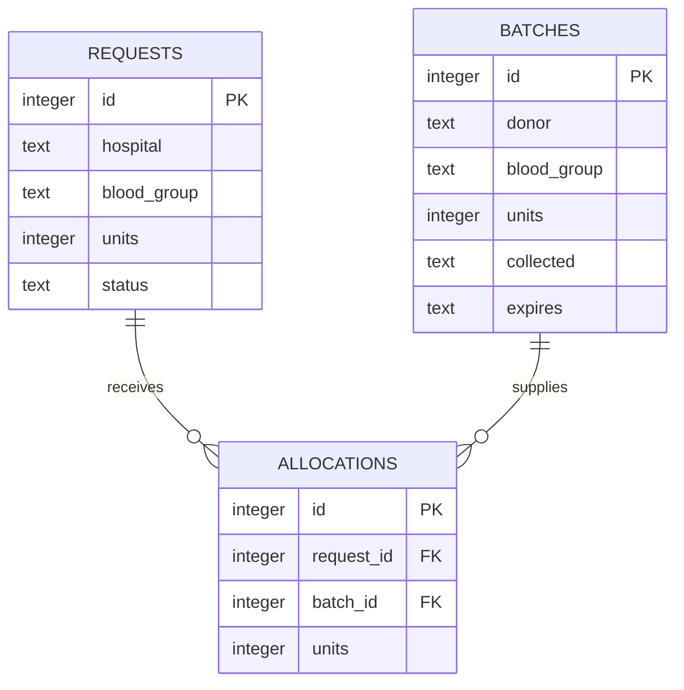

# Online Blood Bank Inventory Management System

**Course:** Web Technology Laboratory · **Programme:** B.Tech, Year III  
**Project name:** LifeFlow  
**Student name / register number:** __________________________  
**Department / institution:** _________________________________

## Abstract

LifeFlow is a web application that maintains blood donation batches and hospital requests in a central inventory. Each batch records its blood group, remaining units, source, collection date and expiry date. The dashboard presents current availability, pending requests, expiry alerts and dispatched units. Hospital request fulfillment automatically allocates unexpired units using first-expiry-first-out order. The application uses HTML, CSS and JavaScript on the frontend, Node.js on the backend and SQLite for persistent storage.

## Problem statement

Manual blood bank registers make it difficult to see current availability, identify soon-to-expire batches and reconcile hospital dispatches. A centralized digital inventory can make these records easier to maintain and reduce duplicate allocation or the accidental inclusion of expired stock.

## Objectives

1. Maintain donation batches for the eight blood groups.
2. Show current stock and low-stock indicators.
3. Track expiry dates and flag batches within seven days of expiry.
4. Record hospital requests and their priority and status.
5. Fulfill requests with atomic, earliest-expiry-first stock deduction.
6. Provide searchable records, exportable reports and an activity trail.

## Modules

| Module | Functions |
|---|---|
| Dashboard | Stock cards, summary metrics, pending requests and activity |
| Inventory | Add donation, search batches, filter by blood group or status |
| Hospital requests | Create, fulfill and cancel requests |
| Expiry monitor | Expired stock and upcoming expiry alerts |
| Reports | Group totals, request summaries and CSV downloads |

## System requirements

- Node.js version 24 or newer.
- A modern desktop or mobile browser.
- Any operating system supporting Node.js.
- No external database installation or npm dependencies.

## Database design

| Table | Main columns | Purpose |
|---|---|---|
| batches | id (PK), donor, blood_group, units, collected, expires, created | Remaining inventory per batch |
| requests | id (PK), hospital, contact, blood_group, units, priority, status, created | Hospital demand and lifecycle |
| allocations | id (PK), request_id (FK), batch_id (FK), units | Dispatch traceability |
| activity | id (PK), description, kind, created | Recent event log |
| settings | key (PK), value | One-time sample-data initialization |

One request has many allocations. One batch can supply many allocations. The allocations table resolves the many-to-many relationship between requests and batches.

## Fulfillment algorithm

1. Begin an immediate database transaction.
2. Load the request and require Pending status.
3. Select same-group batches with remaining units and expiry on or after today.
4. Order batches by expiry date, then batch ID.
5. If total stock is insufficient, roll back and return an error.
6. Deduct units in that order and record each batch allocation.
7. Mark the request Fulfilled, write an activity entry and commit.

This prevents partial updates and repeated deductions. Cancelling a Pending request updates its status without consuming stock.

## Validation and security considerations

The server validates required text, permitted blood groups, integer unit counts, real dates, collection chronology and allowed request states. Queries use bound parameters. The frontend escapes user content before insertion into HTML. CSV output neutralizes formula-like leading characters. The server serves only explicitly allowlisted static files, caps JSON body size and sets a content security policy. The server binds to localhost for the lab demonstration. Authentication and production deployment hardening are future work.

## Test cases

| Test | Expected result |
|---|---|
| Add a valid donation | Saved and reflected in group availability |
| Enter zero, negative or fractional units | Rejected |
| Enter an invalid blood group or impossible date | Rejected |
| Fulfill from two batches | Earliest expiry used first |
| Request exceeds same-group stock | Pending status and stock remain unchanged |
| Only expired or other-group stock exists | Fulfillment rejected |
| Fulfill an already processed request | Rejected; no additional deduction |
| Cancel a Pending request | Cancelled; inventory unchanged |
| Batch expires today | Available today and included in expiry alert |
| Export CSV | Download contains the current records |
| Restart the server | Previously saved data remains available |

Core business cases are automated with `npm test`. UI workflows can be demonstrated using the README walkthrough.

## Limitations and future enhancements

The current application is a single-workspace local lab demonstration using fictional data. Future versions could add authenticated roles, donor registration and eligibility, blood component separation, notifications, audit views and authorized hospital integrations. Real transfusion workflows also require screening, compatibility testing and clinical review beyond inventory group matching.

## Conclusion

LifeFlow demonstrates a complete browser-to-database application with persistent records, validated REST APIs, relational data modeling, transactional stock management and a responsive user interface.

## Viva questions

1. **Why use a database transaction?** To ensure inventory deductions, allocation records and request status changes all succeed together or are all rolled back.
2. **What is FEFO?** First expiry, first out: allocate the earliest-expiring usable stock first.
3. **Why validate on the server?** Browser validation can be bypassed; the server enforces the data rules for every request.
4. **What is a foreign key?** A relationship constraint linking an allocation to an existing batch or hospital request.
5. **How is duplicate dispatch prevented?** Only requests in Pending status may be fulfilled, checked within the transaction.
6. **Why store ISO dates?** ISO calendar dates sort chronologically and are straightforward to validate and compare.
7. **Why use prepared statements?** They separate SQL syntax from data and prevent SQL injection through input values.
8. **Why are requests and allocations separate?** One hospital request may draw units from several batches, and a batch may supply several requests.
9. **How is stock availability calculated?** Sum remaining units for each group, excluding batches with past expiry dates.
10. **What is the role of the REST API?** It connects the browser interface to server-side rules and persistent data using HTTP and JSON.
